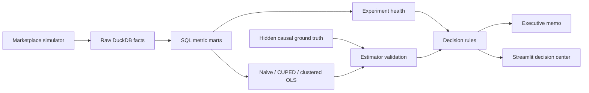

# MarketLift — Marketplace Incentive Experimentation & Causal Inference Platform

[](https://github.com/evanc-hane/market-lift/actions/workflows/ci.yml)
[](https://www.python.org/)
[](LICENSE)

MarketLift evaluates whether a marketplace should launch a **$2 peak-hour courier
incentive**. It combines a reproducible
two-sided marketplace simulator, DuckDB metric layer, geo-switchback experiment, CUPED,
cluster-robust inference, heterogeneous treatment effects, and an executive decision memo.

> Semi-synthetic benchmark. Results do not describe a real company or market.

## Reproducible demo decision

The seeded demo recommends **STOP** for a broad rollout. The incentive increases online
courier supply and courier earnings, but reduces contribution margin by **$4.51 per randomized
two-hour block** (95% CI: **-$5.50 to -$3.52**). This is an intentionally decision-oriented
result: operational improvement alone does not justify an economically negative launch.

See the generated [executive memo](reports/decision_memo.md),
[experiment health checks](reports/experiment_health.md), and
[estimator comparison](reports/primary_results.md).

## Business decision

The platform randomizes courier bonuses at the `zone cluster × 2-hour block` level and asks:

1. Does the bonus increase courier supply and completed orders?
2. Does incremental contribution margin cover incentive cost?
3. Are cancellation, lateness, and courier earnings guardrails protected?
4. Which cities should launch, iterate, or stop?

The final output is `LAUNCH`, `TARGETED_LAUNCH`, `ITERATE`, `STOP`, or
`INVALID_EXPERIMENT` when health checks fail—not merely a p-value.

## System capabilities

| Data science capability | Implementation |
| --- | --- |
| SQL analytics | Point-in-time exposure joins, funnels, unit economics, guardrail marts |
| Experiment design | Balanced geo-switchback assignment and intent-to-treat analysis |
| Experiment health | SRM, covariate balance, A/A calibration, MDE/power analysis, validity gate |
| Causal inference | Naive estimate, CUPED, clustered OLS, stratified randomization inference |
| Heterogeneity | City/maturity effects with Benjamini-Hochberg correction |
| Method validation | Estimator bias against hidden simulator ground truth |
| Product judgment | Predeclared launch rules and executive decision memo |
| Delivery | Tests, coverage, Mypy, Ruff, wheel, Docker, GitHub Actions |

## Architecture



The analysis can access marketplace facts and assignments but not the hidden causal truth.
Ground truth is joined only after estimation to measure bias and absolute error.

## Quick start

```bash
python -m venv .venv
source .venv/bin/activate  # Windows: .venv\Scripts\activate
python -m pip install -e ".[dev]"

marketlift-run --scale demo
streamlit run dashboard/app.py
```

Open `http://localhost:8501`.

Or run the complete application in a container:

```bash
docker compose up --build
```

Scale presets:

- `test`: fast CI fixture
- `demo`: approximately hundreds of thousands of sessions
- `full`: approximately 3 million sessions

Generated DuckDB files are intentionally excluded from Git. Decision reports are reproducible
from a fixed simulator seed and can be regenerated with one command.

## Pipeline

```bash
marketlift-simulate --scale demo
marketlift-build
marketlift-analyze
```

Or run the complete workflow:

```bash
make demo
```

Generated outputs:

```text
reports/experiment_health.md
reports/primary_results.md
reports/decision_memo.md
reports/results.json
```

## Metric definitions

Primary metric:

```text
contribution margin = completed-order commission + delivery fee
                    - courier base pay
                    - courier bonus
                    - refunds
                    - estimated support cost
```

Guardrails include cancellation rate, late-delivery rate, P90 delivery time, and courier
earnings per active hour. See [metric definitions](docs/METRICS.md) and the
[experiment design](docs/EXPERIMENT_DESIGN.md).

## Author

Evan Cui — [GitHub](https://github.com/evanc-hane) —
[evan.cui1022@gmail.com](mailto:evan.cui1022@gmail.com)
